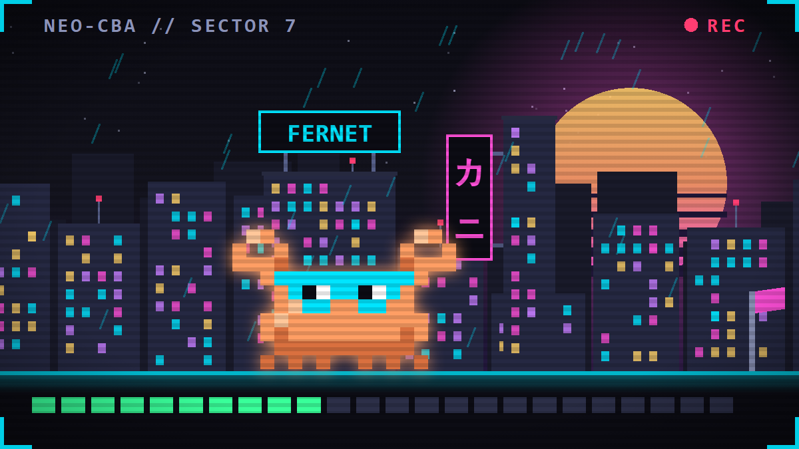
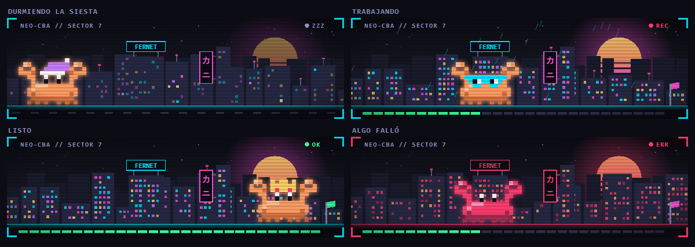
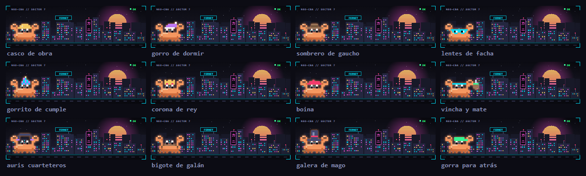

# Tokyo Cyber Crab



Un mod para Claude Code que pone un cangrejo pixelado cordobés al lado del chat. Un panel muestra lo que Claude está haciendo, paso a paso, mientras el cangrejo recorre su ciudad de neón: labura cuando Claude labura, salta cuando la tarea sale, se llena de interferencia cuando algo falla y duerme la siesta entre pedido y pedido. En la app de escritorio toda la ventana toma el mismo look de noche y neón.

[In English](README.en.md)

## Qué hace

- **Un panel en vivo con los pasos de Claude.** Cada herramienta que usa aparece en un renglón con su archivo o comando, cuánto tardó y si salió bien. Varios pasos seguidos del mismo tipo se juntan en uno.
- **El cangrejo recorre tu plan.** Cuando Claude lleva una lista de tareas, el cangrejo avanza por una pista hasta una banderita a medida que las va cerrando.
- **Los subagentes tienen sus propios cangrejos.** Cada uno muestra en qué anda, cuántas herramientas usó y cómo terminó.
- **Un marcador de la sesión.** Pedidos, pasos, fallas y tiempo de laburo, bajo un ecualizador de neón que se mueve mientras Claude trabaja.
- **Una franja de visor sobre el cuadro de texto,** un renglón que cierra cada pedido terminado y una línea de espera que dice cosas como «Pidiéndole un tema a la Mona» en vez de «Thinking».
- **Un look para la app.** Superficies azul noche, acentos de neón y una ciudad de fondo detrás de la conversación, con el cangrejo en una terraza.
- **Doce pilchas,** que se cambia solo cada cinco minutos o cuando se lo pedís, y un cangrejo que opina del laburo con tonada.
- **Un tunga-tunga cortito** cuando termina una tarea con trabajo de verdad. Un comando lo apaga.



## Instalación

En una sesión de Claude Code en la terminal:

```
/plugin install tokyo-crab --marketplace blackat-systems/tokyo-cyber-crab
```

Desde una consola:

```
claude plugin install tokyo-crab --marketplace blackat-systems/tokyo-cyber-crab
```

En la app de escritorio: clic en el + al lado del cuadro de texto, después Plugins, Add marketplace con `blackat-systems/tokyo-cyber-crab`, y Add plugin.

Instalado para el usuario, el mod se carga en todas las sesiones que abras después, las de la app de escritorio incluidas.

## Dónde se ve

| | App de escritorio | Terminal |
| --- | --- | --- |
| Panel, franja de visor, renglón de cierre, línea de espera | Sí, con el cangrejo animado | Sí, con un cangrejo de texto |
| Colores de la app y ciudad de fondo | Sí | No: la terminal no dibuja looks |

Para la terminal hay un tema de colores a juego en `themes/neo-cordoba.json`. Copialo a `~/.claude/themes/` y poné `"theme": "custom:neo-cordoba"` en `~/.claude/settings.json`.

## Comandos

| Comando | Con `language: en` | Qué hace |
| --- | --- | --- |
| `/cangrejo` | `/crab` | Abre el panel. También se abre solo al empezar una sesión. |
| `/cangrejo-ropa` | `/crab-outfit` | Le cambia la pilcha al cangrejo. |
| `/cangrejo-opina` | `/crab-talk` | El cangrejo comenta cada tarea terminada. Viene apagado, porque cada comentario es una consulta chica al modelo. |
| `/cyber-sonido` | `/cyber-sound` | Prende o apaga el sonido de fin de tarea. |
| `/cyber` | `/cyber` | Prende o apaga los colores de la app, el fondo, la franja de visor y la línea de espera. El panel se queda. |

## Opciones

| Opción | Valores | De fábrica |
| --- | --- | --- |
| `language` | `es`, el castellano de Córdoba con el que nació el cangrejo, o `en` para inglés | `es` |
| `name` | La etiqueta sobre tus propios mensajes | vacío, que muestra `VOS` (`YOU` en inglés) |

El instalador las pregunta. Para cambiarlas después, editá `~/.claude/settings.json`:

```json
{
  "pluginConfigs": {
    "tokyo-crab@tokyo-crab": {
      "options": { "language": "es", "name": "Joa" }
    }
  }
}
```

## El ropero



## La paleta

Una sola paleta, en [`hooks/palette.ts`](hooks/palette.ts), pinta la app, el panel y la ciudad. Cada neón dice una sola cosa.

| Color | Hex | Qué dice |
| --- | --- | --- |
| Magenta | `#ff4fd8` | La marca: las marcas de sección, el cartel, la banderita |
| Cian | `#00e5ff` | Vivo: lo que está corriendo ahora |
| Verde | `#39ff9a` | Salió bien |
| Rojo | `#ff3d71` | Falló |
| Naranja | `#ff9e64` | El cangrejo |

El texto va sobre superficies azul noche, de `#14141f` a `#1f2030`. Todos los colores de texto guardan un contraste de 4.7:1 o más en cualquiera de ellas, y el color de etiqueta más apagado guarda 5.3:1.


## Límites

- Hecho y probado en Windows, en la app de escritorio, con Claude Code 2.1.325. La API de mods es de acceso anticipado y puede cambiar de una versión a otra.
- En una versión de Claude Code que todavía no acepta colores para la app, el mod pone sólo la ciudad de fondo.
- El sonido de fin de tarea sale por PowerShell en Windows y por el reproductor propio de Claude Code en macOS. No se probó en macOS ni en Linux, y una terminal de Linux no tiene reproductor: ahí, silencio.
- El look es sólo oscuro. La ciudad no tiene versión de día.

## Desarrollo

```
claude plugin validate .
claude plugin test .
node tools/preview.mjs
```

El último escribe `tools/preview.html` con todo el arte: la paleta, cada humor y cada pilcha, los cangrejos de los subagentes, el ecualizador y el fondo. Pide Node 22.15 o más nuevo.

El arte es SVG puro armado en [`hooks/scene.ts`](hooks/scene.ts); las frases y la ropa del cangrejo están en [`hooks/fun.ts`](hooks/fun.ts), y todos los textos en los dos idiomas, en [`hooks/i18n.ts`](hooks/i18n.ts).

## Créditos

La noche sigue el espíritu de [Tokyo Night](https://github.com/tokyo-night/tokyo-night-vscode-theme), de enkia. `hooks/make-colors.js` es el generador de colores del kit de mods de Claude Code, copiado tal como ese kit indica. El sonido lo genera `sounds/make_tunga.py`. El cartel de la torre dice カニ, «kani», cangrejo en japonés.

Es un mod independiente: no está afiliado a Anthropic ni cuenta con su aval.

Licencia MIT. Ver [LICENSE](LICENSE).
